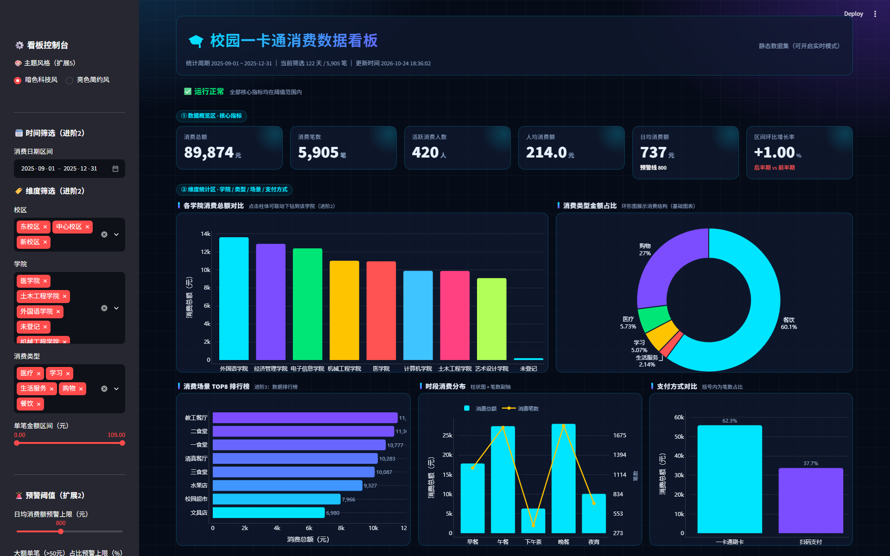
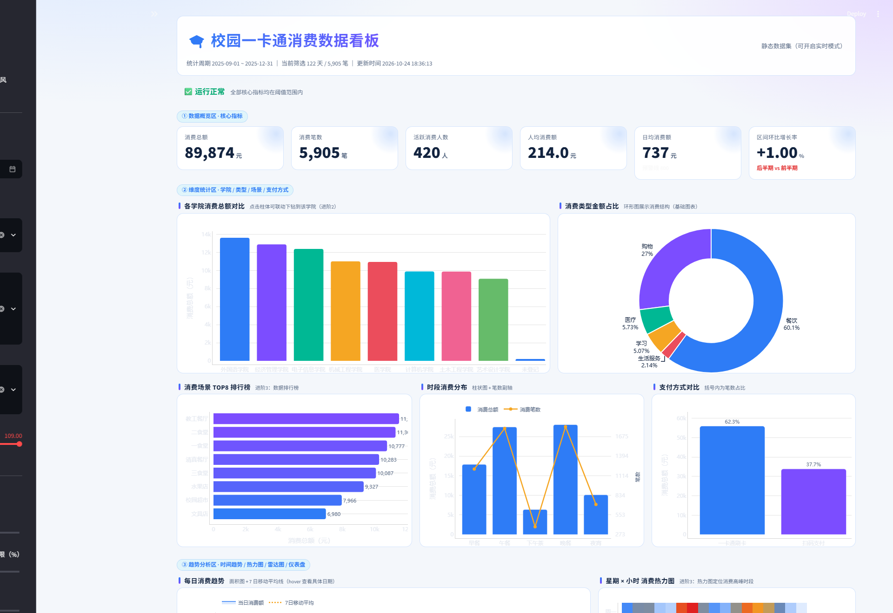
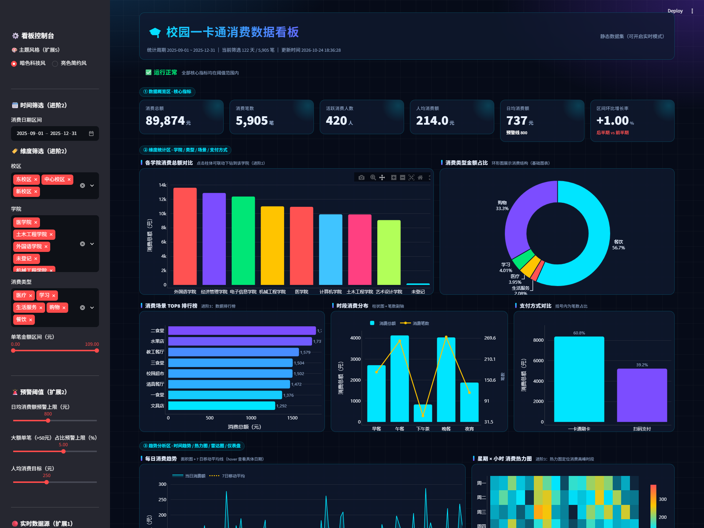
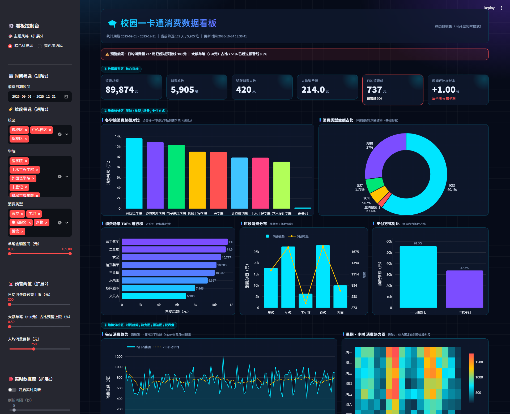
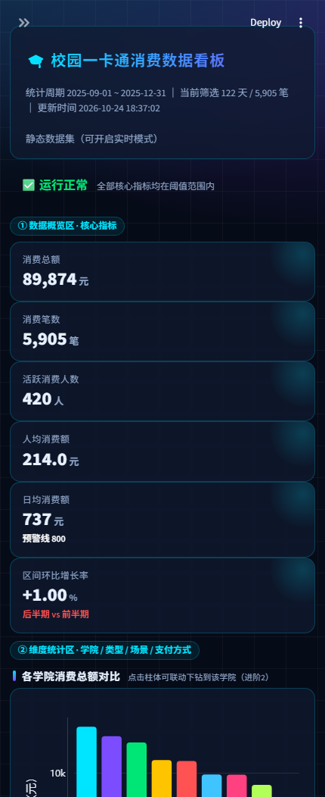
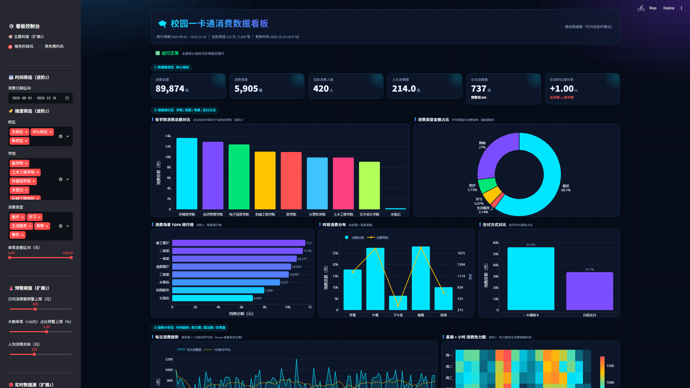

# 🎓 校园一卡通消费数据看板 · 实验2

> 《Python 程序设计》实验2 —— **数据看板的设计与实现**
> 基于 **Streamlit + Pandas + Plotly** 从零实现的交互式数据看板，覆盖基础任务全部 5 项、进阶任务 3 项、扩展任务 5 项。


---

## ✨ 成果预览

| 暗色科技风（整页） | 亮色简约风 |
|:---:|:---:|
|  |  |

| 图表联动下钻 | 阈值预警触发 |
|:---:|:---:|
|  |  |

| 移动端适配（430px） | 2560px 大屏 |
|:---:|:---:|
|  |  |

---

## 🗂️ 项目结构

```
exp2-data-dashboard/
├── app.py                     # Streamlit 看板主程序（四大模块 + 全部交互）
├── generate_data.py           # 模拟数据生成（6000+ 条原始流水，人为注入脏数据）
├── preprocess.py              # 数据预处理（去重/空值/异常值/维度整理）
├── requirements.txt           # 依赖清单
├── data/
│   ├── raw_campus_card_data.csv       # 原始数据（含脏数据）
│   └── clean_campus_card_data.csv     # 清洗后数据（看板数据源）
├── utils/
│   ├── style.py               # 主题系统 + 全局 CSS（暗色/亮色双主题）
│   ├── charts.py              # 10 类 Plotly 图表组件工厂
│   └── data_loader.py         # 数据加载与缓存
├── tools/
│   ├── capture_screenshots.py # Chrome CDP 自动截图脚本
│   └── test_charts.py         # 图表组件单元自测
├── docs/                      # 实验报告
└── screenshots/               # 成果截图（8 张）
```

## 🚀 快速开始

```bash
# 1. 安装依赖
pip install -r requirements.txt

# 2. 重新生成模拟数据（可选，仓库已附带生成好的数据）
python generate_data.py
python preprocess.py

# 3. 启动看板
streamlit run app.py
```

浏览器自动打开 `http://localhost:8501` 即可。

**演示快捷入口（URL 参数，便于截图复现）：**

| 参数 | 效果 | 示例 |
|---|---|---|
| `?theme=亮色简约风` | 切换亮色主题 | `http://localhost:8501/?theme=亮色简约风` |
| `?college=计算机学院` | 直接进入该学院下钻态 | `http://localhost:8501/?college=计算机学院` |
| `?thr_daily=300&thr_big=0.5` | 压低预警阈值，触发预警条 | `http://localhost:8501/?thr_daily=300&thr_big=0.5` |

## 🔁 完整复现说明

### A. 只复现看板（推荐，最省事）

仓库里已经带了生成好的原始数据与清洗后数据，不需要重跑数据管道：

```bash
git clone https://github.com/dan051203000-wq/exp2-data-dashboard.git
cd exp2-data-dashboard
pip install -r requirements.txt
streamlit run app.py
```

打开 `http://localhost:8501` 即可看到完整看板。

### B. 从零复现全部产出（数据 → 清洗 → 看板 → 截图 → 报告）

| 步骤 | 命令 | 产出 |
|---|---|---|
| 1. 安装依赖 | `pip install -r requirements.txt` | — |
| 2. 生成模拟原始数据 | `python generate_data.py` | `data/raw_campus_card_data.csv`（6040 条，含脏数据） |
| 3. 数据预处理 | `python preprocess.py` | `data/clean_campus_card_data.csv`（5905 条） |
| 4. 启动看板 | `streamlit run app.py` | 本机 `http://localhost:8501` |
| 5. 自动抓图 | **另开一个终端**，保持看板运行，执行 `python tools/capture_screenshots.py` | `screenshots/*.png`（8 张） |
| 6. 生成版面草图 | `python tools/make_sketch.py` | `docs/layout_sketch.png` |
| 7. 生成实验报告 | `python tools/make_report.py` | `docs/实验2 数据看板的设计与实现-实验报告.docx` |

> 第 5 步依赖本机 Chrome：`tools/capture_screenshots.py` 通过 **Chrome DevTools Protocol（CDP）** 直连浏览器截图，
> **不需要 chromedriver**。脚本会自动完成「真实点击柱体下钻」「触发预警条」等交互后再截图，
> 若某步自动化点击失败会自动回退到 URL 参数演示模式。

### C. 环境注意事项

- 本机实测环境：**Python 3.11.4 / Streamlit 1.66.1 / Pandas 3.1.0 / Plotly 7.1.0**
- Plotly 7 已移除 `titlefont` 属性，自定义坐标轴标题必须写 `title=dict(text=..., font=dict(...))`，否则会报错
- 数据表用 UTF-8-SIG 编码，避免 Excel 打开 CSV 中文乱码
- 若 `pip install` 慢，可换清华源：`-i https://pypi.tuna.tsinghua.edu.cn/simple` |

## 📊 业务场景与数据

**场景**：某高校 2025 秋季学期（2025-09-01 ~ 2025-12-31）校园一卡通消费流水。

- **原始数据**：6040 条，模拟 4 个校区 × 10 个学院 × 420 名学生的消费行为，**人为注入**重复记录、空值、异常值（单笔 -999/99999 元、学期外日期）等脏数据；
- **清洗后**：5905 条（保留率 97.76%），含时间/地点/学院/消费类型/支付方式等多维字段；
- 数据由 `generate_data.py` 按真实作息规律生成（三餐高峰、周末低谷、昼夜节律），保证可视化结果有真实"数据故事"。

## ✅ 任务完成清单

### 基础任务（必做 · 全部完成）

| # | 任务 | 实现要点 |
|---|---|---|
| 1 | 需求分析与版面设计 | 四大模块布局 + 暗色科技风配色方案 + 版面草图（见实验报告） |
| 2 | 数据准备与预处理 | 生成 6040 条含脏数据流水；去重 54 / 补空值 61 / 剔异常 20 条 |
| 3 | 基础可视化图表 | 6 张 KPI 数据卡片、柱状图、折线图、环形图（超过 3 种要求） |
| 4 | 静态看板整合 | 统一 CSS 设计系统、卡片圆角阴影、视觉层级、间距字号统一 |
| 5 | 结果验证与总结 | 8 张自动化成果截图 + 问题清单（见实验报告第五节） |

### 进阶任务（选做 · 完成 3 项）

| # | 任务 | 实现要点 |
|---|---|---|
| 1 | 动态视觉效果 | KPI 数值滚动动画、组件渐入动画、图表 hover 悬浮提示 |
| 2 | 图表联动与筛选 | 时间/校区/学院/类型/金额五维筛选联动；**点击柱状图直接下钻**至该学院 |
| 3 | 多维度分析可视化 | 场景消费排行榜、星期×小时热力图、学院雷达图、人均目标仪表盘 |

### 扩展任务（创新 · 完成 5 项）

| # | 任务 | 实现要点 |
|---|---|---|
| 1 | 实时数据看板 | 侧边栏开启实时模式，模拟动态数据流 + 秒级自动刷新 |
| 2 | 数据预警监控 | 日均消费额 / 大单占比双阈值滑块，超限触发红色预警条 + KPI 变色 |
| 3 | 大屏与移动端 | 2560px 大屏自适应布局 + 430px 移动端单列堆叠适配 |
| 4 | 统计分析与报告导出 | 一键导出清洗后 CSV / Excel，自动生成 Markdown 分析结论 |
| 5 | 个性化定制 | 暗/亮双主题一键切换、图表点击钻取、URL 参数直达演示状态 |

## 🖼️ 全部截图

| 文件 | 内容 |
|---|---|
| `01-overview-dark-fold.png` | 暗色主题首屏 |
| `02-overview-dark-full.png` | 暗色主题整页 |
| `03-light-theme.png` | 亮色简约主题 |
| `04-drilldown-college.png` | 点击柱体联动下钻 |
| `05-alert-warning.png` | 阈值预警触发 |
| `06-realtime-mode.png` | 实时数据流模式 |
| `07-mobile.png` | 移动端适配（430×932） |
| `08-bigscreen-2560.png` | 大屏适配（2560px） |

## 🛠️ 技术要点

- **Streamlit** 组件化布局（columns / container / tabs）+ `st.cache_data` 数据缓存
- **Plotly Graph Objects** 手写 10 类图表工厂，统一主题色注入
- **Pandas** 完整清洗管线：去重 → 空值填补 → IQR 异常值剔除 → 维度派生
- **Chrome DevTools Protocol** 自动化截图（`tools/capture_screenshots.py`），无 chromedriver 依赖
